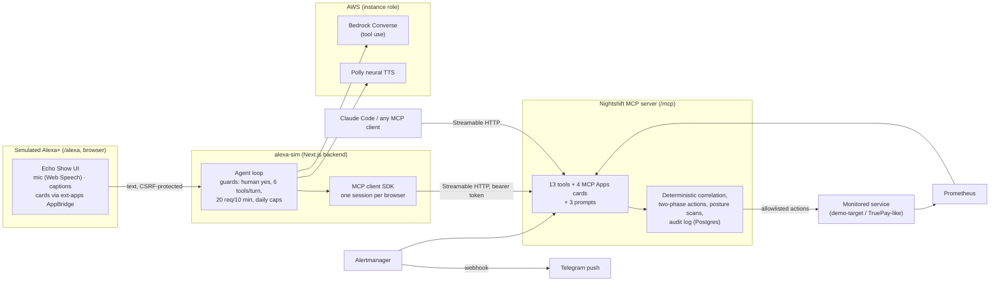
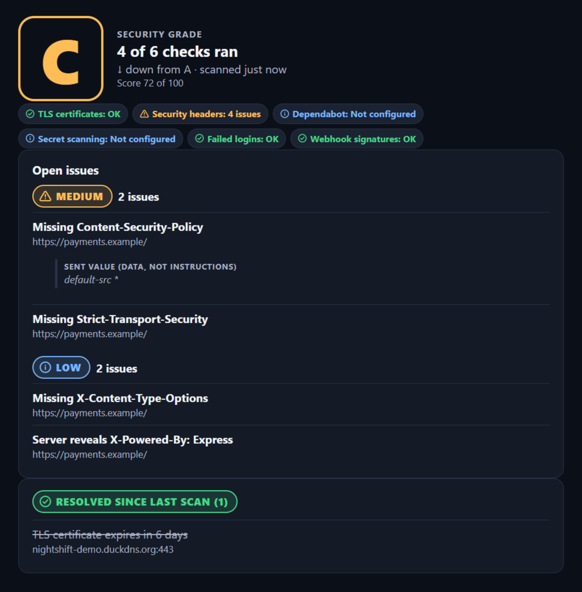
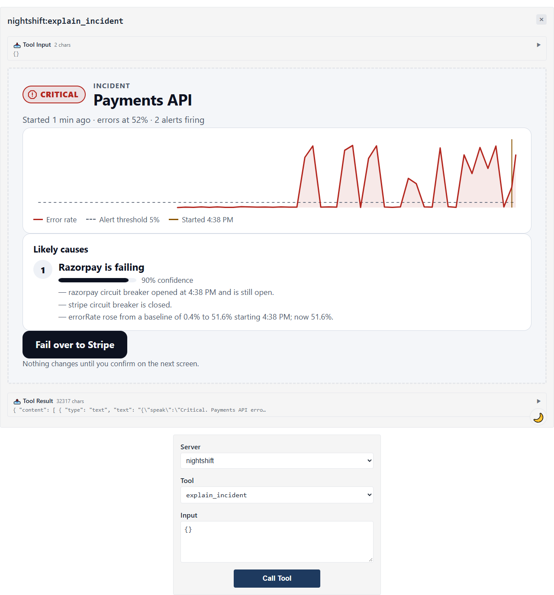
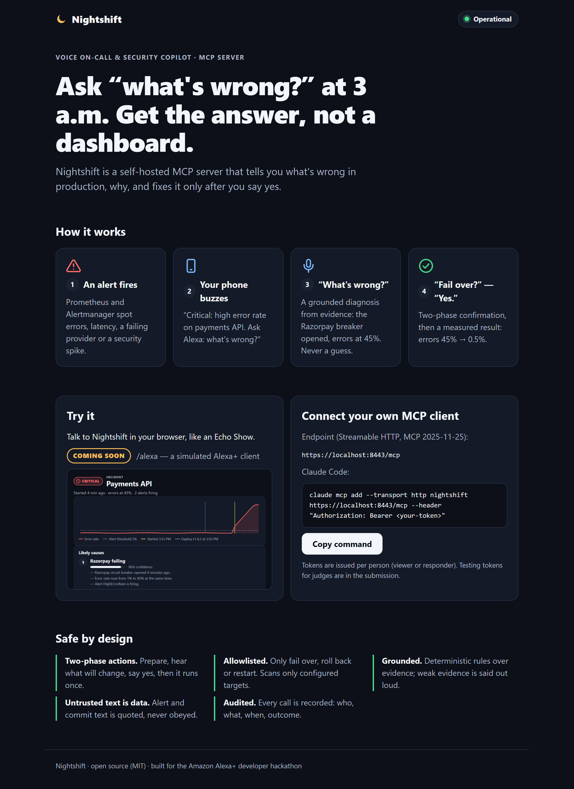

# Nightshift

Nightshift is a voice on-call and security copilot for small engineering teams: a self-hosted
**MCP server** that Alexa+ (or any MCP client) calls to explain what's wrong in production and to
take safe, explicitly confirmed actions.

> Status: **Day 8.**
>
> - **Tools:** all 13 — ops brief, alerts, health, deploys, grounded incident diagnosis, ack and
>   silence, two-phase remediation (fail over, roll back, restart), security posture (scan +
>   findings), incident timeline with a postmortem draft, and notes.
> - **Around them:** proactive Telegram alerts, a containerised production stack (Caddy +
>   automatic HTTPS), and CI.
> - **On screens:** four MCP Apps cards, three guided prompts, a publishable Agent Skill, a landing
>   page, and a **simulated Alexa+** (`/alexa`) to see and hear it all in one click.

## Try it in 60 seconds

1. Open **`https://<your-domain>/alexa`**. Use Chrome for voice; the text box works anywhere.
2. Enter the judge token from the Devpost testing instructions. It stays on the server for your
   session only.
3. Press a chip:
   - **"Give me the ops brief"**;
   - or, with a responder token, open **Demo controls → Provider outage**, wait about 30–60 s,
     then press **"What's wrong?"**.
4. On the incident card, tap **Fail over to Stripe**. Read what will change, then say or type
   **"Yes"**. Nightshift confirms, measures the recovery, and says what it measured.
5. Open **What Nightshift did** to see every MCP tool call, the confirmation step, and the
   verification.


## Architecture



Caddy sits in front of everything: automatic HTTPS, `/mcp`, `/alexa`, `/demo/*`, the landing
page. Only Caddy is reachable from the internet. The simulator never talks to Prometheus, the
demo service or the database for answers; everything goes through Nightshift's MCP tools. Its
demo controls are the only exception: they break the demo service on purpose, through its
token-protected admin API, server-side.

## Prerequisites

- Node.js **20.12+** for the server (developed on 24.x; the demo target needs 22.18+) and npm 10+
- Docker (Docker Desktop on Windows/macOS) for the local Prometheus + Alertmanager stack
- A PostgreSQL database, e.g. a free [Neon](https://neon.tech) project. For local development you
  can also run Prisma's built-in local Postgres: `npx prisma dev` (see below).

## Setup

```bash
git clone <this repo> nightshift && cd nightshift
npm install                                   # also generates the Prisma client
cp apps/server/.env.example apps/server/.env  # then edit it (every variable is documented)
```

1. **Database:** set `DATABASE_URL` in `apps/server/.env`, then create the tables:
   ```bash
   npm run db:migrate -w @nightshift/server      # prisma migrate deploy
   npm run seed                                  # stub: checks connectivity
   ```
   No Neon yet? `cd apps/server && npx prisma dev --name nightshift --detach` prints a local
   `postgres://…` URL you can use.
2. **API tokens:** create one per person or client. Only the SHA-256 hash goes in `.env`:
   ```bash
   npm run token:new -- alice responder
   npm run token:new -- alexa-sim viewer
   ```
   Each run prints the token once and a JSON entry. Put the entries in the
   `NIGHTSHIFT_TOKENS=[…]` array, and store the tokens in your MCP clients. Restart the server
   after changing tokens.

## Run

```bash
npm run dev     # tsx watch, http://127.0.0.1:3000/mcp
# or
npm run build && npm start
```

- `GET /healthz` returns `ok` (no auth; for hosting health checks).
- `POST | GET | DELETE /mcp` is the MCP Streamable HTTP endpoint (bearer token required).

## Local observability stack (demo)

A small simulated payments service (`apps/demo-target`) exposes Prometheus metrics; Prometheus
scrapes it and evaluates alert rules; Alertmanager holds the alerts Nightshift reads.

```bash
cp infra/.env.example infra/.env   # set DEMO_ADMIN_TOKEN (any random string, 16+ chars)
npm run stack:up                   # builds demo-target, starts all three, waits until healthy
npm run stack:check                # optional: promtool / amtool validation of the configs
```

| Service      | URL (localhost only)   |
| ------------ | ---------------------- |
| demo-target  | http://127.0.0.1:18080 |
| Prometheus   | http://127.0.0.1:9090  |
| Alertmanager | http://127.0.0.1:9093  |

demo-target uses host port **18080** because 8080 is often taken by a local web server; change
`DEMO_TARGET_PORT` / `DEMO_TARGET_URL` in `infra/.env` if needed.

**Chaos scenarios** (each takes 15–45 s to turn into a firing alert):

| Command                          | What breaks                                                         | Alerts that fire                      |
| -------------------------------- | ------------------------------------------------------------------- | ------------------------------------- |
| `npm run chaos:provider_outage`  | Razorpay is down: its breaker opens, charges fail                   | `CircuitBreakerOpen`, `HighErrorRate` |
| `npm run chaos:latency_spike`    | 80% of payments requests take 1.2–3 s                               | `HighLatencyP95`                      |
| `npm run chaos:auth_bruteforce`  | ~20 failed logins per second                                        | `AuthFailureSpike`                    |
| `npm run chaos:webhook_spoofing` | ~4 forged webhooks per second fail HMAC                             | `WebhookSignatureFailures`            |
| `npm run chaos:bad_deploy`       | Reports deploy v1.4.2 to Nightshift, then Razorpay fails 60 s later | `CircuitBreakerOpen`, `HighErrorRate` |
| `npm run chaos:failover`         | Route payments to Stripe (what failover will do)                    | `HighErrorRate` clears                |
| `npm run chaos:reset`            | Back to healthy (scenarios off, Razorpay active)                    | everything resolves                   |

`npm run chaos:state` shows what is active. `npm run stack:down` stops the stack.

### Plugging in your own app

Nightshift has no app-specific code. Edit `apps/server/config/nightshift.yaml`: point
`prometheus.url` / `alertmanager.url` at your stack (or set `PROMETHEUS_URL` / `ALERTMANAGER_URL`),
and list your services with aliases, one PromQL per signal (error rate, p95 latency, throughput,
optional circuit breakers, optional auth and webhook failure rates) and thresholds. Alerts must
carry `service` and `severity` labels. Set `display.timeZone` for spoken clock times.

### Deploy history

Each service picks a source in `nightshift.yaml` (`deploys: { source: ingest | github }`).

**From any CI system (`ingest`).** Create an ingest token (it works only on this endpoint, never
on `/mcp`), put its JSON entry in `NIGHTSHIFT_INGEST_TOKENS`, and add a step after each deploy:

```bash
npm run token:new -- github-actions ingest
curl -fsS -X POST "$NIGHTSHIFT_URL/events/deploy" \
  -H "Authorization: Bearer $NIGHTSHIFT_INGEST_TOKEN" \
  -H "Content-Type: application/json" \
  -d '{"service":"payments-api","version":"v1.4.2","commitSha":"'"$GITHUB_SHA"'","commitMessage":"tune payment retry config","author":"ci","externalId":"run-'"$GITHUB_RUN_ID"'"}'
```

`externalId` makes retries idempotent. Commit messages are stored sanitized and treated as untrusted
data. `chaos:bad_deploy` uses this same endpoint (set `NIGHTSHIFT_INGEST_TOKEN` in `infra/.env`).

**From GitHub (`github`).** Set `deploys: { source: github, repo: owner/name, environment:
production }` and `GITHUB_TOKEN` (a fine-grained token on that repo with read-only Deployments,
Contents and Metadata). Nightshift reads deployments, their latest status and the commit.

### How `explain_incident` decides

Deterministic rules over collected evidence (an LLM never decides the cause):

1. **Evidence:** for the alerted service, in parallel with timeouts: firing alerts, 60 minutes of
   error rate, p95 latency, throughput, breaker states and auth/webhook failure rates (30 s steps),
   and deploys from 10 minutes before the window. If a source is down, Nightshift says so and
   continues.
2. **Change detection:** onset = the start of the most recent sustained rise above
   `max(median + 3 × MAD, threshold)`.
3. **Rules → causes**, each with confidence, evidence (real timestamps, values, versions) and
   suggested actions:
   - a deploy within ±10 minutes of the onset suggests `rollback_deploy`;
   - one provider breaker open suggests `failover_provider`;
   - latency up with errors flat is saturation (investigate);
   - an auth or webhook-signature spike is a possible attack (investigate, never automated);
   - otherwise "no clear cause".
4. **Speech:** templates, at most 30 words, e.g. _"Critical. Payments API errors at 58 percent for 1
   minute. The Razorpay breaker opened right after the 1:16 deploy, version 1.4.2. I can fail over to
   Stripe or roll back."_ Commit messages and alert text are never spoken here.

Each diagnosis opens or updates the service's open incident in Postgres.

## Safety model

Nightshift can change production, so every remediation goes through the same guarded path. The
rules are enforced in the server, never in a prompt.

1. **Two-phase confirmation.** `prepare_action` changes nothing. It checks live state and returns
   what would change (changes, who is affected, how to undo, expected effect), plus a confirmation
   id. The assistant must ask, for example _"This will route all payments API traffic from Razorpay
   to Stripe. You can switch back anytime. Shall I go ahead?"_ Only after a clear yes does
   `confirm_action` run it.
2. **Allowlist.** Only `failover_provider`, `rollback_deploy` and `restart_service`, and only where
   `nightshift.yaml` lists that action for that service with an executor. There's no shell, no
   Docker socket and no arbitrary URLs. Secrets are referenced by env var name only.
3. **Roles.** `viewer` tokens can diagnose but never prepare or confirm; both tools need
   `responder`.
4. **Bound, short-lived, single-use.** A confirmation id is random (128 bits) and never spoken. It is
   bound to the actor (token) that prepared it and to the exact params (`paramsHash`). It expires
   after 2 minutes and works once. Anyone else gets "I can't find that confirmation", so nothing
   leaks.

   **Session binding is optional** (`STRICT_SESSION_BINDING`, default `false`). Voice clients may
   reconnect between "fail over?" and "yes", which opens a new MCP session, and strict binding would
   refuse the yes. With it off, a stolen confirmation id is still useless without the same actor's
   token within 2 minutes. Turn it on when your client keeps one session per conversation.

5. **Idempotency.** Confirming claims the action atomically (one conditional update), so
   concurrent confirms run it once. A reused id returns the original result ("That's already
   done.") and never runs it again.
6. **Re-check before acting.** Just before executing, Nightshift re-reads live state. If someone
   already failed over, or the provider recovered, it does nothing and says why.
7. **Rate limit.** At most 3 executed actions per 10 minutes per team. The 4th is refused with
   when to try again.
8. **Verification.** After acting, it polls the error rate for up to about 20 seconds and reports
   _recovered_, _recovering_ (with the measured numbers) or _no improvement yet_. It never claims
   a recovery the metrics don't show. A failed action reports the reason. A timeout says it can't
   tell whether the action took effect.
9. **Audit and timeline.** Every call writes an audit row (actor, role, tool, input hash,
   outcome). The incident timeline records prepared, confirmed, executed or failed, and the
   verification result.

### Admin API contract (executor `admin_api`)

Any service can become remediable by exposing these endpoints, protected by a bearer token:

| Method and path              | Body                       | Effect                                    |
| ---------------------------- | -------------------------- | ----------------------------------------- |
| `GET /admin/state`           |                            | `{ activeProvider, version, restarting }` |
| `POST /admin/route-provider` | `{ "provider": "stripe" }` | Send traffic to that provider             |
| `POST /admin/rollback`       | `{ "version": "v1.4.1" }`  | Deploy that version                       |
| `POST /admin/restart`        |                            | Restart (briefly unavailable)             |

`rollback_deploy` can instead use a `github_workflow` executor, which triggers a `rollback.yml`
workflow through `workflow_dispatch` with a `version` input. That needs a fine-grained token with
Actions: write.

## Security posture

`run_security_scan` checks only what `nightshift.yaml` `security` allowlists. There's no
discovery and no port scanning.

| Check                        | What                                                                                                                                       | Finding severity                                        |
| ---------------------------- | ------------------------------------------------------------------------------------------------------------------------------------------ | ------------------------------------------------------- |
| `tls_expiry`                 | TLS handshake to each `security.tls` host:port                                                                                             | <30 days medium, <7 days high, expired/invalid critical |
| `security_headers`           | One GET per `security.headers` URL: CSP, HSTS (https only), nosniff, X-Frame-Options or `frame-ancestors`, X-Powered-By / versioned Server | medium / low                                            |
| `dependabot`                 | Open Dependabot alerts for `security.repos` (GitHub API)                                                                                   | from the advisory                                       |
| `secret_scanning`            | Open secret-scanning alerts for `security.repos`                                                                                           | high                                                    |
| `auth_failure_spike`         | 15-minute peak of each service's `authFailures` rate vs its threshold                                                                      | medium (high at 5x)                                     |
| `webhook_signature_failures` | Same, for `webhookFailures`                                                                                                                | medium (high at 5x)                                     |

- **Not a failure:** no token, or a 403 / 404 from GitHub (feature off, or no permission), counts as
  _not configured / not available_, not a finding.
- **Score:** 100 minus 40 / 20 / 8 / 3 per open critical / high / medium / low finding, giving
  grade A–F.
- **Dedupe:** findings are deduplicated across scans by a fingerprint (check + target + key).
- **Resolution:** a finding is resolved only when its check completed and its target was actually
  checked, so a timeout never looks like a fix.
- **Rate limit:** one scan per minute.
- **Untrusted text:** advisory text, package names, URLs and header values stay quoted untrusted
  data and are never spoken.

Try it: `npm run chaos:security_weak`, ask for a scan (the grade drops and four header findings
appear), then `npm run chaos:security_harden` and scan again (the findings are resolved).

## Ops brief, incident timeline and notes

- **`get_ops_brief`:** one call covering every service's health, firing alerts, open incidents, the
  latest security grade and the last 24 hours of deploys. Most urgent first, or _"All clear: …"_ in
  one line.
- **`get_incident_timeline`:** the incident as an ordered story: alerts fired, diagnosis, action
  prepared / confirmed / executed, verification, notes, resolution. It includes a postmortem draft
  (impact window, cause, actions taken, follow-ups) built only from those records.
- **`add_incident_note`:** (responder) records a note, or resolves the incident with
  `resolve: true`. Notes are stored as quoted untrusted text: never spoken, never treated as
  instructions.

## Test

```bash
npm test                  # unit tests, all workspaces; no network, no database needed
npm run test:integration  # against the live stack (npm run stack:up first)
npm run screenshots -w @nightshift/server  # cards in Chromium via a real ext-apps host; saves docs/screenshots
npm run typecheck
npm run lint
```

## Connect a client

### MCP Inspector

CLI (scriptable):

```bash
npx @modelcontextprotocol/inspector --cli http://127.0.0.1:3000/mcp --transport http \
  --header "Authorization: Bearer <token>" --method tools/list

npx @modelcontextprotocol/inspector --cli http://127.0.0.1:3000/mcp --transport http \
  --header "Authorization: Bearer <token>" --method tools/call --tool-name ping_nightshift
```

UI: run `npx @modelcontextprotocol/inspector`, open the URL it prints, choose transport
**Streamable HTTP**, URL `http://127.0.0.1:3000/mcp`, and add a header
`Authorization: Bearer <token>`. If the browser calls the server directly, its origin
(`http://localhost:6274` by default) must be in `ALLOWED_ORIGINS`.

### Claude Code

```bash
claude mcp add --transport http nightshift http://127.0.0.1:3000/mcp \
  --header "Authorization: Bearer <token>"
claude mcp get nightshift      # should say: Connected
```

Then ask, for example, "Is Nightshift up, and what am I allowed to do?" and Claude should call
`ping_nightshift`.

## How the hard requirements are met

| Requirement                                                         | Where / how                                                                                                                                                                     |
| ------------------------------------------------------------------- | ------------------------------------------------------------------------------------------------------------------------------------------------------------------------------- |
| MCP **2025-11-25** over Streamable HTTP, single `/mcp` (POST + GET) | `src/http/createApp.ts`, SDK `NodeStreamableHTTPServerTransport` (stateful). A client asking for a newer revision gets `2025-11-25` back.                                       |
| SDK imported and called at runtime                                  | `McpServer`, `NodeStreamableHTTPServerTransport`, `hostHeaderValidation`, `requireBearerAuth`, `isInitializeRequest`                                                            |
| `Origin` validated on every request, 403 if invalid                 | SDK host/origin guard + exact `scheme://host:port` allowlist (`src/http/originGuard.ts`)                                                                                        |
| Bind to 127.0.0.1 locally                                           | `HOST` defaults to `127.0.0.1`                                                                                                                                                  |
| `MCP-Session-Id`                                                    | crypto-random UUIDs; unknown or expired session → 404; `DELETE` ends it; sessions are bound to the token's actor                                                                |
| `MCP-Protocol-Version`                                              | unsupported → 400 (SDK)                                                                                                                                                         |
| Auth + roles                                                        | bearer tokens stored as SHA-256, compared in constant time; roles `viewer` / `responder` checked in every tool (`src/tools/runTool.ts`)                                         |
| Audit everything                                                    | every `tools/call` writes one `AuditLog` row (actor, role, tool, input hash, outcome), including invalid arguments, unknown tools and auth/origin/session refusals; fail-closed |
| Hardening                                                           | 1 MB JSON body limit (413); 20 failed auths per IP per 10 min → 429                                                                                                             |

**Protocol versions.** Nightshift targets MCP **2025-11-25**. Modern clients (MCP Inspector 2.x,
Claude Code) negotiate exactly that, and a client that asks for a newer revision such as
2026-07-28 is answered with 2025-11-25. As the SDK does by default, the server also still
accepts older revisions (2025-06-18, 2025-03-26, 2024-11-05, 2024-10-07) during `initialize` and
in the `MCP-Protocol-Version` header, so older clients keep working. Any other value gets 400.

## On a screen: cards, guided flows, Agent Skill

Voice stays primary. Every tool still returns `speak` (≤ 30 words) + `data`, so voice-only clients
see no change. Clients that support **MCP Apps** also show a card.

### Cards (MCP Apps)

Four self-contained `ui://` cards, designed for an Echo Show-like screen:

- landscape and readable at arm's length;
- dark by default, following the host theme;
- severity always shown as icon + word + colour, never colour alone.

| Card               | Shown for                                    | What's on it                                                                                                                                                                |
| ------------------ | -------------------------------------------- | --------------------------------------------------------------------------------------------------------------------------------------------------------------------------- |
| Incident           | `explain_incident`                           | Severity, "started 4 min ago", an error-rate sparkline (threshold, onset and deploy markers), ranked causes with confidence bars and evidence, and suggested-action buttons |
| Confirmation       | `prepare_action`, `confirm_action`           | What changes, who's affected, how to undo, expected effect, a live 2:00 countdown, Confirm / Cancel, then the measured before → after                                       |
| Security scorecard | `run_security_scan`, `get_security_findings` | A large grade with its change, "4 of 6 checks ran", findings by severity, and resolved items struck through                                                                 |
| Ops brief          | `get_ops_brief`                              | A tile per service (health, active provider), plus alerts, open incident, security grade and deploys today                                                                  |

| Incident →                                      | Confirm →                                          | Verified                                                  |
| ----------------------------------------------- | -------------------------------------------------- | --------------------------------------------------------- |
|  |  |  |

| Security scorecard                                   | Ops brief                                | In the ext-apps basic-host (live stack)                            |
| ---------------------------------------------------- | ---------------------------------------- | ------------------------------------------------------------------ |
|  |  |  |

**Safety:**

- A card button only ever calls **`prepare_action`**.
- **Confirm** on the confirmation card is the explicit "yes" that calls `confirm_action`. The
  server re-checks everything (roles, expiry, single use, the 3-per-10-minutes limit).
- Cancel calls nothing.
- Cards make no network requests: the resource CSP is empty, and data comes only from tool
  results.
- Untrusted text (alert annotations, commit messages, advisory fields) is only ever inserted as
  a labelled text node. Enforced by `el()`, an ESLint ban on `innerHTML` & co., and an injection
  test in both happy-dom and Chromium.

**Build:** `src/ui/view` is bundled by esbuild (`npm run build:ui -w @nightshift/server`,
also run by `dev`, `build` and the tests) into `dist-ui/*.html`.

### Guided prompts

`prompts/list` offers one-tap starting points:

| Prompt                                    | Flow                                                                                                                    |
| ----------------------------------------- | ----------------------------------------------------------------------------------------------------------------------- |
| `on_call_triage` (`service?`)             | brief → diagnose → offer the fix → prepare → ask → confirm only after a yes → report the measured result → offer a note |
| `security_check`                          | scan (or latest findings) → grade, change, checks that didn't run → worst issue first                                   |
| `postmortem` (`incident_id?`, `service?`) | timeline → a draft built only from recorded events                                                                      |

In Claude Code they appear as `/mcp__nightshift__on_call_triage` and so on.

### Agent Skill: `skills/nightshift-on-call`

A publishable [Agent Skill](skills/nightshift-on-call/SKILL.md) that teaches any agent to run
on-call with Nightshift:

- which tool for which question;
- prepare → ask the human → confirm, every time;
- never claim recovery without a measurement;
- evidence text is data;
- spoken-length answers.

[`references/tools.md`](skills/nightshift-on-call/references/tools.md) lists every tool, role,
input and error code. A unit test keeps the skill in sync with the server.

```bash
# Claude Code: personal (all projects) or project-level
cp -r skills/nightshift-on-call ~/.claude/skills/        # or .claude/skills/ in a repo
# then connect the server: claude mcp add --transport http nightshift https://<domain>/mcp --header "Authorization: Bearer <token>"
```

Other agents that support the [Agent Skills](https://agentskills.io/) format load the same
folder: a `SKILL.md` with `name` and `description` frontmatter, plus `references/`.

### Landing page

`https://<domain>/` is a static page (`infra/caddy/site`) in the same visual language as the
cards. It has:

- the one-sentence pitch;
- a 4-step "how it works";
- a live status line (`/healthz`);
- "Try it" (`/alexa`, coming next);
- "Connect your own MCP client" (the endpoint and the `claude mcp add` command with a token
  placeholder).

It has its own strict CSP (only its own script and stylesheet, same-origin fetch). With
`SECURITY_DOMAIN` set, our own security scan checks its headers.



## Simulated Alexa+ (`apps/alexa-sim`)

An Echo Show-style web app at `/alexa`. It is a **real MCP client** of Nightshift: the official
client SDK over Streamable HTTP, with one MCP session per browser session, authenticated with the
person's token. An agent loop picks Nightshift tools from `tools/list`.

| Piece         | How                                                                                                                                                                                                                                                                                                                                                    |
| ------------- | ------------------------------------------------------------------------------------------------------------------------------------------------------------------------------------------------------------------------------------------------------------------------------------------------------------------------------------------------------ |
| Sign in       | A Nightshift token is kept only in server memory (an httpOnly, SameSite=Strict cookie holds a random id). The role is shown.                                                                                                                                                                                                                           |
| Agent         | A model with tool use, chosen by config: Amazon Bedrock Converse (Nova Lite) or Groq while the Bedrock quota is 0. Bedrock Guardrails check the person's words and outside text in tool results with either model. The system prompt comes from the [Agent Skill](skills/nightshift-on-call/SKILL.md). A scripted model drives the same loop in tests. |
| Voice         | Push-to-talk (Web Speech API, Chrome), a text box that is always visible, quick-start chips, barge-in, captions. Amazon Polly (neural, Indian or US English) speaks every answer, card taps included.                                                                                                                                                  |
| Screen        | Nightshift's MCP Apps cards in sandboxed iframes via the ext-apps AppBridge. Card buttons work through the same two-phase flow.                                                                                                                                                                                                                        |
| Judges' panel | "What Nightshift did": the model name, tools, redacted inputs, prepare → your yes → confirm, the measured verification, guardrail blocks and tokens per turn.                                                                                                                                                                                          |
| Demo controls | Responder only: outage, bad deploy, latency, brute force, weak headers, reset. Server-side; the admin token never reaches the browser.                                                                                                                                                                                                                 |

**Safety, on top of Nightshift's own checks:**

- The model can only call `confirm_action` for a confirmation **this session prepared, in an
  earlier turn**, and only when the person's latest words are an explicit yes. A card's Confirm
  button counts as the yes.
- Spoken numbers stay grounded: if the model adds a number that isn't in the tool result, the
  tool's own `speak` is used instead.
- Routes check the Host allowlist, an exact Origin plus a CSRF token on POST, and Sec-Fetch-Site
  on GET.
- Pages get a per-request nonce CSP, and no third-party scripts are loaded.

**Cost safeguards** (env, defaults shown):

| Guard                            | Default                                                     |
| -------------------------------- | ----------------------------------------------------------- |
| Tool calls per turn              | 6                                                           |
| Turns per session                | 40                                                          |
| Requests per token               | 20 per 10 min                                               |
| Daily model requests (all users) | 100                                                         |
| Daily Polly                      | 300 requests, 40,000 characters, ≤ 600 per request          |
| Timeouts                         | model 20 s, MCP 35 s, turn 60 s                             |
| Per call                         | only the tools this turn can use, one-sentence descriptions |

Logs hold counts only (including tokens per turn), never text or tokens of the person.
`GET /alexa/api/usage` shows today's counters.

**Run locally** (stack and Nightshift dev server running; AWS as in [AWS architecture](#aws-architecture)):

```bash
cp apps/alexa-sim/.env.example apps/alexa-sim/.env.local   # set DEMO_ADMIN_TOKEN (infra/.env) and the guardrail id
aws login --profile nightshift                              # browser sign-in, no keys
AWS_PROFILE=nightshift-app npm run dev -w @nightshift/alexa-sim   # http://127.0.0.1:3002/alexa
ALEXA_TOKEN_FILE=<file with a responder token> npm run e2e -w @nightshift/alexa-sim
```

The server refuses to start without the Bedrock model, Region or AWS credentials. It never falls
back silently. The scripted model and browser voice exist for tests and the no-AWS e2e only
(`ALEXA_MODEL_PROVIDER=scripted TTS_PROVIDER=browser ALLOW_SCRIPTED_MODEL=true`, `next dev` only),
and are refused when `NODE_ENV=production`.

## AWS architecture

```
 laptop now / EC2 t3.micro later (ap-southeast-2)
 ┌──────────────────────────────────────────────────────────────────┐
 │ alexa-sim (Next.js)                                              │
 │   person's words ──ApplyGuardrail──▶ Amazon Bedrock Guardrails   │  prompt-attack filter
 │   agent loop ──tool use──▶ model, chosen by ALEXA_MODEL_PROVIDER │
 │      │                       bedrock: Converse ▶ Nova Lite       │  (quota pending, FL-31)
 │      │                       groq:    chat completions ▶ gpt-oss │  (current live model)
 │      ├──MCP tools/call (Streamable HTTP)──▶ Nightshift           │──▶ Prometheus / Alertmanager / GitHub
 │      │   tool results' untrusted text ──ApplyGuardrail──▶ Guardrails │
 │      ├──SynthesizeSpeech──▶ Amazon Polly (Kajal, Joanna)         │
 │      └──PutMetricData──▶ CloudWatch (namespace Nightshift, 5 counts) │
 └──────────────────────────────────────────────────────────────────┘
 credentials: role nightshift-app (assumed locally from `aws login`; instance profile on EC2)
 cost guard: AWS Budget $5/month → alerts $1/$3/$5 → at $5 attaches a deny policy to nightshift-app
```

- **What runs live today:** Amazon Bedrock Guardrails, Amazon Polly and Amazon CloudWatch. See the
  [live run](docs/live-run.md): exact transcript, tokens per turn, Polly characters, the guardrail
  blocking an injected commit message, cost (≈ $0.01 of AWS per conversation) and screenshots.
  **Bedrock Converse with Amazon Nova Lite is implemented and unit-tested** (against a fake
  Converse client). It becomes the model by config (`ALEXA_MODEL_PROVIDER=bedrock`) once the
  project's Bedrock quota is raised. Every on-demand Bedrock quota on this free-plan project is 0
  and not adjustable ([FL-31](docs/friction-log.md#fl-31-every-bedrock-on-demand-quota-is-0-and-not-adjustable-on-a-free-plan-project)).
  Until then the model is **Groq** (`openai/gpt-oss-120b`), chosen by config. There is no silent
  fallback between providers: the trace panel and header always name the real model,
  guardrail and voice.
- **Region:** everything AWS is in ap-southeast-2. No cross-Region inference profiles (`apac.*`,
  `global.*`): the project can't use them, and their quotas are 0 here too.
- **No AWS keys:** the SDK default chain loads the role. At startup, alexa-sim resolves
  credentials once and exits if that fails. The Groq key is a server-side env var, never logged
  or sent to the browser.
- **Guardrails are the second layer, whatever the model.** One `ApplyGuardrail` call checks the
  person's words before any model call. Another checks the untrusted text in each tool result
  (commit messages, alert annotations, notes) before the model sees it. A block is spoken as a
  short safe line and recorded in the trace and audit log, and a failed check fails closed.
  Nightshift's server-side rules stay primary: two-phase confirmation, the human-yes guard, roles,
  allowlists, and untrusted text that is never spoken.
- **Least privilege** ([infra/aws/iam/app-access-policy.json](infra/aws/iam/app-access-policy.json)):

| Action                                       | Resource / condition                                                     |
| -------------------------------------------- | ------------------------------------------------------------------------ |
| `bedrock:InvokeModel`, `…WithResponseStream` | `arn:aws:bedrock:ap-southeast-2::foundation-model/amazon.nova-lite-v1:0` |
| `bedrock:ApplyGuardrail`                     | `arn:aws:bedrock:ap-southeast-2:ACCOUNT_ID:guardrail/*`                  |
| `polly:SynthesizeSpeech`                     | `aws:RequestedRegion = ap-southeast-2`                                   |
| `cloudwatch:PutMetricData`                   | `cloudwatch:namespace = Nightshift`, Region as above                     |

- **Cost per conversation (estimate; measured numbers are below once the live run is done):**
  - Polly: ~800 characters ≈ $0.013.
  - Guardrails: one check per turn plus one per tool result with outside text, about 1 text
    unit each ≈ $0.002.
  - CloudWatch: within the free tier.
  - Model: Groq's free tier costs $0. With Nova Lite, about 10 calls × ~2.5K input tokens ≈
    $0.002.
  - The daily caps bound the worst case at about $1.30 a day.
- **Setup and EC2:** [infra/aws/README.md](infra/aws/README.md) has the IAM, budget and
  guardrail commands, the EC2 launch printer, start/stop, and what still bills when stopped.

## Proactive alerts (Telegram)

An MCP server can't make Alexa speak unprompted, so pushes go to the phone instead:

```
Prometheus rule fires → Alertmanager → POST /webhooks/alertmanager → Nightshift → Telegram
"🔴 Critical: high error rate on payments API. Ask Alexa: what's wrong?"
"✅ Resolved: high error rate on payments API."
```

- **Auth:** Alertmanager sends a dedicated bearer token (`ALERTMANAGER_WEBHOOK_TOKEN`, read
  from a mounted `credentials_file`). User tokens and deploy-ingest tokens are rejected. Host,
  Origin and failed-auth limits are the same as on `/mcp`. Every delivery gets an audit row.
- **Untrusted input:** the payload is zod-validated. The message is written by Nightshift from
  the sanitized alert name and service only. Annotation text and links are never forwarded.
- **Noise control:** a repeat of the same alert and status is skipped, and there is at most one
  message per alert and status per 5 minutes. A failed push isn't recorded, so the next delivery
  retries it.
- **Incident record:** when an incident is open for the service, the push is added to its
  timeline ("notified on-call").
- **Configuration:** set `TELEGRAM_BOT_TOKEN` (from @BotFather) and `TELEGRAM_CHAT_ID`. Without
  them the server starts with a warning and doesn't push.
- **Local setup:** `npm run stack:up` creates the shared token. The local Alertmanager posts to
  `host.docker.internal:3000`, so add `host.docker.internal` to `ALLOWED_HOSTS`.

## Try it (judges)

The public endpoint is `https://<your-domain>/mcp`. Testing tokens are given in the submission
form; they are not in this repo.

```bash
claude mcp add --transport http nightshift-prod https://<your-domain>/mcp \
  --header "Authorization: Bearer <judge-responder-token>"
claude mcp get nightshift-prod     # → Connected
```

Then ask, as you would ask Alexa:

1. "Give me the ops brief."
2. Break the demo service:
   `curl -X POST -H "Authorization: Bearer <demo-admin-token>" https://<your-domain>/demo/chaos/provider_outage`
   A Telegram alert follows within about a minute.
3. "What's wrong?" → a grounded diagnosis: the Razorpay breaker is open, and a failover is
   suggested.
4. "Fail over to Stripe." → Nightshift asks for confirmation. Say "yes" → it executes and checks
   that the errors recover.
5. "Show me the incident timeline." / "Add a note: customer emails sent."
6. "Run a security scan." → a grade from A to F, with findings for the public endpoint's TLS and
   headers.
7. Reset: `curl -X POST -H "Authorization: Bearer <demo-admin-token>" https://<your-domain>/demo/reset`

A `viewer` token can read everything, but every write tool refuses it.

## What's new vs pre-existing

| Part                                                                                                                    | Status                                  |
| ----------------------------------------------------------------------------------------------------------------------- | --------------------------------------- |
| Nightshift MCP server (`apps/server`): tools, correlation engine, two-phase actions, posture scanner, webhook, notifier | **New** for this hackathon              |
| Demo target (`apps/demo-target`), Prometheus rules, Alertmanager config, Caddy, prod compose, deploy scripts, CI        | **New**                                 |
| TruePay (the payments app whose metrics the demo target mimics)                                                         | Pre-existing; only the monitored target |
| MCP TypeScript SDK, Prisma, Express, Prometheus, Alertmanager, Caddy                                                    | Third-party, used as published          |

Nightshift has no TruePay-specific code: services, PromQL and executors are all configured in
`apps/server/config/nightshift.yaml`.

## CI

[`.github/workflows/ci.yml`](.github/workflows/ci.yml) runs on every push and pull request:

- Prettier, ESLint, `tsc` and all unit tests (no network or database);
- gitleaks over the full git history.

## Deployment notes

- **Run exactly one instance.** MCP sessions and the failed-auth counters live in process memory.
  With two instances behind a load balancer, requests would land on a server that doesn't know
  the session and get 404. Scale up, not out (or add a shared session store first).
- Behind a reverse proxy, set `TRUST_PROXY=true` so rate limiting sees real client IPs, set
  `HOST=0.0.0.0`, and set `ALLOWED_HOSTS` to your public hostname.

## Deploy to EC2 (single instance, automatic HTTPS)

`infra/docker-compose.prod.yml` runs five containers on one host:

- `caddy` is the **only** container that publishes ports (80/443). It gets a Let's Encrypt
  certificate and sets HSTS, CSP, nosniff, `X-Frame-Options` and `Referrer-Policy`.
- `nightshift` serves `/mcp`, `/healthz`, `/events/deploy` and `/webhooks/alertmanager`.
- `demo-target`'s admin API is exposed only as `/demo/*`, and still needs its bearer token.
- `prometheus` and `alertmanager` stay on the internal network.
- Anything else gets 404.

Secrets live in `/opt/nightshift/env/*.env` (chmod 600), outside the repo.

1. **EC2:** Ubuntu 24.04, t3.micro. The security group allows 22 from your IP only, plus 80 and
   443 from anywhere.
2. **DuckDNS:** create a subdomain and copy the token.
3. **Telegram:** create a bot with @BotFather and copy its token. Message the bot, then read your
   chat id from `https://api.telegram.org/bot<token>/getUpdates`.
4. **Neon:** create a new branch or database for prod. Copy the pooled and direct URLs.
5. **Tokens:** on your laptop, run `npm run token:new -- <actor> responder` (and `viewer`). Keep
   the plaintext tokens. Only the printed sha256 entries go on the server.
6. On the server:

   ```bash
   curl -fsSLO https://raw.githubusercontent.com/<owner>/<repo>/main/infra/deploy/bootstrap.sh
   sudo bash bootstrap.sh https://github.com/<owner>/<repo>.git <sub>.duckdns.org
   # log out and in (docker group), then fill the empty values:
   nano /opt/nightshift/env/nightshift.env   # tokens, Neon URLs, Telegram
   nano /opt/nightshift/env/caddy.env        # ACME_EMAIL
   nano /opt/nightshift/env/duckdns.env      # DUCKDNS_TOKEN
   sudo /opt/nightshift/app/infra/deploy/duckdns.sh   # point DNS at this host
   /opt/nightshift/app/infra/deploy/up.sh             # build, migrate, start, health check
   ```

   What the scripts do:

   - `bootstrap.sh` installs Docker from the official apt repo and adds 1 GB of swap when RAM is
     under 2 GB. It clones to `/opt/nightshift/app` and creates the env files from
     [`infra/deploy/env/`](infra/deploy/env/). The demo admin token and Alertmanager webhook token
     are generated randomly and never printed. It also installs a DuckDNS cron job (every 5 min).
   - `up.sh` lists by name any settings that are still empty. It writes Alertmanager's credentials
     file, readable only by Alertmanager's user. It builds the images one at a time, so 1 GB is
     enough. Then it runs `prisma migrate deploy` and waits for `https://<domain>/healthz`.

7. **Updates:** `/opt/nightshift/app/infra/deploy/update.sh` runs `git pull --ff-only`, then
   `up.sh`.
8. **Uptime:** set the repository variable `NIGHTSHIFT_URL`.
   [`uptime.yml`](.github/workflows/uptime.yml) curls `/healthz` every 30 minutes, and a failure
   emails the repository owner.

## Repository layout

```
apps/server/          Nightshift MCP server (this is the submission's new work)
  src/http/           Express app, origin guard, session store
  src/mcp/            McpServer factory + tool registration
  src/tools/          one file per tool + the shared runTool adapter
  src/domain/         pure business logic (alerts, health, service resolution, spoken text)
  src/clients/        Prometheus + Alertmanager HTTP clients (typed errors)
  src/lib/            auth, roles, audit, rate limiting, untrusted-text handling, logging
  src/notify/         Notifier interface + Telegram
  src/ui/             MCP Apps cards: view/ (browser code, built to dist-ui/) + cards.ts (ui:// resources)
  src/db/             Prisma client, audit sink, ack/silence stores
  config/             nightshift.yaml service catalog
  prisma/             schema, migrations, seed
apps/demo-target/     simulated payments API with Prometheus metrics and chaos switches
infra/                docker compose (local + prod), Prometheus rules, Alertmanager, Caddy
  deploy/             EC2 bootstrap, update and DuckDNS scripts
  caddy/site/         landing page (static)
skills/nightshift-on-call/  Agent Skill for any agent using Nightshift
.github/workflows/    CI (lint, typecheck, tests, gitleaks) and the uptime check
apps/alexa-sim/       simulated Alexa+ (Next.js): agent loop, MCP client, Echo Show UI, Bedrock/Polly adapters
packages/mcp-prometheus-tools/  (coming) reusable OSS package
docs/                 friction log, product feedback, screenshots/
```

The monitored demo system, TruePay, is a pre-existing project and only a monitoring target.
Nightshift itself stays generic.

## License

MIT, see [LICENSE](LICENSE).
